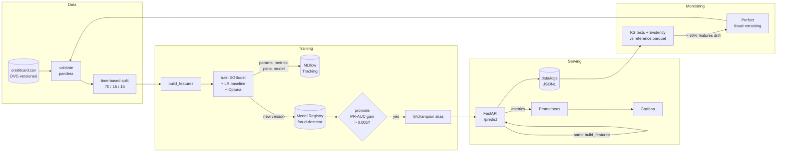

# Credit-Card Fraud Detection — End-to-End MLOps

**A production-style fraud-detection system: versioned data, validated inputs, tracked experiments, automatic champion/challenger promotion, a Dockerized FastAPI service, CI/CD, and drift monitoring that triggers retraining, with dashboards.**

[](https://github.com/durvesh-24/credit-card-fraud-detection-mlops/actions/workflows/ci.yml)   

## Architecture



| Layer | Tool | Why |
|---|---|---|
| Data versioning | DVC (local remote, S3/GDrive ready) | Git tracks a tiny pointer; the 150 MB CSV lives in cache/remote |
| Data validation | pandera | Fail fast on schema/type/range errors before training |
| Experiment tracking + registry | MLflow (aliases `@champion` / `@challenger`) | Every run reproducible; deploy = move an alias |
| Model | XGBoost (`scale_pos_weight`) vs logistic-regression baseline, Optuna tuning | Strong on tabular, imbalance-aware |
| Serving | FastAPI + pydantic + uvicorn | Typed validation, automatic 422s, OpenAPI docs |
| Observability | prometheus-fastapi-instrumentator, Prometheus, Grafana | Throughput, latency percentiles, errors, flag rate |
| Drift | scipy KS test + Evidently report | Statistical trigger + human-readable report |
| Orchestration | Prefect | Retries, scheduling, observable flows |
| Packaging / CI/CD | Docker, Docker Compose, GitHub Actions → GHCR | Same image everywhere; every push tested |

## Results

> **Placeholders — fill in after running `dvc repro` on the real Kaggle data.** Numbers come from
> `reports/metrics.json` (also in the MLflow UI). Never invented, never tuned on test.

| Model | Val PR-AUC | **Test PR-AUC** | Test ROC-AUC | Test Precision | Test Recall | Test F1 | Threshold (from val) |
|---|---|---|---|---|---|---|---|
| Logistic regression (baseline) | _TBD_ | _TBD_ | _TBD_ | _TBD_ | _TBD_ | _TBD_ | _TBD_ |
| XGBoost | _TBD_ | _TBD_ | _TBD_ | _TBD_ | _TBD_ | _TBD_ | _TBD_ |
| XGBoost + Optuna | _TBD_ | _TBD_ | _TBD_ | _TBD_ | _TBD_ | _TBD_ | _TBD_ |

Serving (from Grafana under load): p50 _TBD_ ms · p95 _TBD_ ms · p99 _TBD_ ms.

*Why PR-AUC, not accuracy?* Fraud is ~0.17% of transactions, so a model that never flags fraud scores 99.83% accuracy and is useless. PR-AUC measures how well fraud is ranked above legitimate traffic, focusing on the rare positive class.

## Quick start

Prerequisites: Python 3.11, Git, Docker Desktop. See [docs/PROJECT_GUIDE.md](docs/PROJECT_GUIDE.md) for a full install guide.

```bash
# 1. environment
python -m venv .venv                     # Windows: py -3.11 -m venv .venv
source .venv/bin/activate                # Windows PowerShell: .venv\Scripts\Activate.ps1
pip install -r requirements.txt
cp .env.example .env                     # Windows: copy .env.example .env

# 2. data: download creditcard.csv from Kaggle (mlg-ulb/creditcardfraud) into data/raw/, then version it
dvc add data/raw/creditcard.csv
git add data/raw/creditcard.csv.dvc data/raw/.gitignore && git commit -m "Track raw data with DVC"
dvc push                                 # needs a remote, see "DVC remote" below

# 3. start the stack: MLflow :5000, API :8000, Prometheus :9090, Grafana :3000
docker compose up -d --build

# 4. run the pipeline (validate -> split -> train) and promote the first champion
dvc repro
python -m src.promote

# 5. tell the API to load the champion, and set the threshold printed by training
#    (edit FRAUD_THRESHOLD in .env, then: docker compose up -d api)
curl -X POST localhost:8000/reload
```

> **Port already in use?** If another program on your machine uses 8000, 3000, 5000 or 9090, set `API_PORT`, `GRAFANA_PORT`, `MLFLOW_PORT` or `PROMETHEUS_PORT` in `.env` (e.g. `API_PORT=8001`), keep `API_URL` in sync, and use those ports in the commands below.

Try it at http://localhost:8000/docs, or:

```bash
curl -X POST localhost:8000/predict -H "Content-Type: application/json" \
     -d '{"Time": 406, "Amount": 149.62, "V": [0,0,0,0,0,0,0,0,0,0,0,0,0,0,0,0,0,0,0,0,0,0,0,0,0,0,0,0]}'
```

No real data yet? `python scripts/make_sample_data.py` writes a **synthetic** file with the same schema so you can exercise every step. Its metrics mean nothing.

### DVC remote

The default remote is a local folder, configured in the git-ignored `.dvc/config.local`:

```bash
dvc remote add --local -d localstorage /path/outside/the/repo/dvc-storage
```

To share data with a team or CI, switch to cloud storage (credentials come from the environment, never from git):

```bash
pip install "dvc[s3]"   && dvc remote add -d storage s3://my-bucket/fraud-dvc        # uses AWS_* env vars / ~/.aws
pip install "dvc[gdrive]" && dvc remote add -d storage gdrive://<folder-id>           # OAuth on first push
dvc push
```

## Demo: drift → retrain → promote

```bash
python scripts/simulate_drift.py --n 500 --no-drift   # 1. normal traffic
python -m src.monitor                                  #    -> "No significant drift."
python scripts/simulate_drift.py --n 500               # 2. Amount x3, noise on V1..V12
python -m src.monitor                                  #    -> 13/29 features drifted (> 30%): retrain
open reports/drift_report.html                         # 3. Evidently's per-feature view
python -m src.flows monitor                            # 4. Prefect: drift check -> fraud-retraining subflow
python scripts/rollback.py --list                      # 5. see versions, @champion, @challenger
```

What to expect in step 4: a new version is registered and tagged `@challenger`. It becomes `@champion` only if it beats the current champion's test PR-AUC by more than 0.005. If the raw data hasn't changed, the retrained model is essentially the same and **the gate correctly keeps the old champion**. In real life, retraining runs on *newly labelled* data (`dvc add` a new snapshot), which is what lets a model adapt. When promotion happens, the flow calls `POST /reload` and the API starts serving the new champion without a restart. If a promoted model misbehaves, roll back with `python scripts/rollback.py --version <N>` and `POST /reload`.

Grafana (http://localhost:3000, user/password from `.env`) → *Fraud Detection API*: watch requests/s, p50/p95/p99 latency, error rate and the flagged-transaction rate move as the simulator runs.

Schedule monitoring daily at 06:00:

```bash
prefect server start                                   # terminal 1 (persistent Prefect UI on :4200)
export PREFECT_API_URL=http://127.0.0.1:4200/api       # terminal 2 (PowerShell: $env:PREFECT_API_URL=...)
python -m src.flows serve
```

## Data drift vs. concept drift

- **Data drift (covariate shift)**: the *inputs* change, P(X). Example: average amounts triple after a new merchant category launches. You can detect it immediately, without labels, by comparing live feature distributions to training (what `src/monitor.py` does with KS tests).
- **Concept drift**: the *relationship* between inputs and fraud changes, P(y | X). Example: fraudsters adopt a new pattern that looks like normal spending. Inputs may look unchanged, so data-drift tests can miss it. Detecting it needs **labels** (chargebacks, investigations), which arrive days or weeks later. You then track live precision/recall/PR-AUC.
- **Prediction drift**: the distribution of model *outputs* shifts (Grafana's fraud-score and flag-rate panels). It's a cheap early warning that something changed, though it can't say what.

Data drift doesn't always hurt accuracy, and concept drift can happen with no data drift at all. That's why retraining decisions should ultimately be based on labelled performance.

## Limitations

- Retraining reuses the latest labelled snapshot in `data/raw/`; API logs carry no labels, so there's no feedback loop of ground truth yet. Concept drift is therefore not monitored.
- KS tests on large samples flag tiny, harmless shifts. 29 tests at p < 0.01 also produce occasional false positives (no multiple-testing correction).
- Promotion compares models on the same test set every time; repeated selection on one test set slowly overfits it. A fresh, recent holdout or shadow traffic is better.
- `Time` is seconds since the first transaction, so `hour` is an offset, not the true clock hour. V1–V28 are anonymised PCA components, so the model can't be explained in business terms.
- The threshold is set manually via `FRAUD_THRESHOLD`; it isn't tied to the model version automatically.
- Prediction logging writes JSONL synchronously on the request path, and `/reload` is unauthenticated. Both are fine locally, not in production.
- A single API replica and a SQLite MLflow backend: no horizontal scaling or HA.

## Next steps

- Feedback loop: join chargeback labels onto logged predictions; monitor live precision/recall and concept drift.
- Read the threshold from the model version's `threshold` tag (already logged) instead of an env var; tune it on business cost (missed fraud vs. analyst time).
- Shadow / canary deployment of `@challenger` on live traffic before promotion.
- PSI / Wasserstein drift with multiple-testing correction; alerting via Grafana alert rules or Prometheus Alertmanager.
- Move to Postgres + S3 (MinIO) for MLflow, Kubernetes for serving, async log shipping (Kafka).
- Explainability (SHAP) per prediction; feature store (Feast) if real features are added.

## Project layout

See [docs/PLAN.md](docs/PLAN.md) for the folder tree. [docs/PROJECT_GUIDE.md](docs/PROJECT_GUIDE.md) explains every file and the full tech stack, and [docs/INTERVIEW_QA.md](docs/INTERVIEW_QA.md) has interview questions and terminology.

```bash
ruff check .        # lint
pytest              # 49 tests, no MLflow server or real data needed
dvc dag             # validate -> split -> train
```
